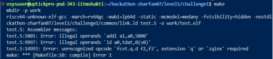
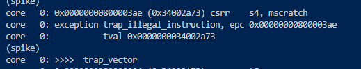
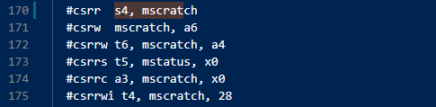
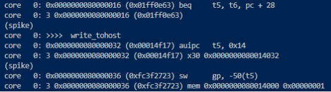

Challenge1 Problem Solving.

Error when I run make:

Based on the errors, I commented out all the illegal operands from line 5001, 9997, 14993

Then I run “riscv64-unknown-elf-gcc -march=rv64gc -mabi=lp64d -nostdlib -nostartfiles -T link.ld test.S -o work/test.elf” to generate the dump, disass and elf files.

Then with the .elf file, I run spike and saw the program had raise exception after address 0x80000204:

I noticed that the file contains instructions from various extensions such as I, M, A, F, D, C,  zicsr and zi fence. The header of the file is limited to RV64U, so it is impossible to run the file as a singular file.

Run spike and this instruction triggered exception so I comment it out:

Commented out the line that cause the exception:

Edited init to enter machine mode and enable floating point instructions:
.purgem init
.macro init
    RVTEST_ENABLE_MACHINE
    RVTEST_FP_ENABLE
.endm

Test pass:

