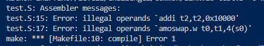
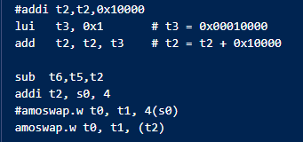
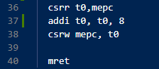
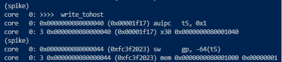

Level 1, Challenge 2 Problem Solving

After running make, encounter error:

For test.S line 15, the error occurs because the range for immediate numbers are -2048 to +2047.

For test.S line 17, the syntax for the atomic instruction is faulty.

Here is how I fix the illegal operands error:

The second problem is when the program goes into mtvec_handler, it goes to trap_vector then loops back to mtvec_handler. The code does not go into illegal_instruction to continue the program.

To solve the infinite loop, the mepc must be properly set.

Now the program exit sucessfully:

