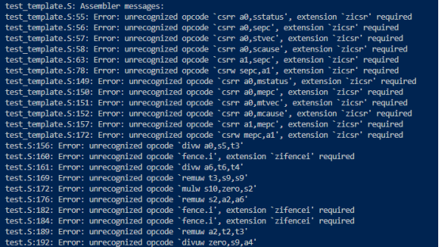
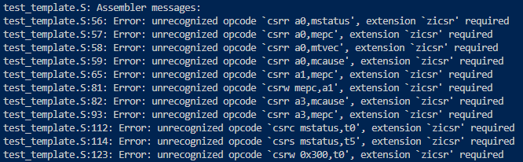

Level 2, challenge 1 Problems and Fix

Snippet of errors when run “make”:

Fix, I noticed some are instructions for rv64, so in the isa-instruction-distribution, I cleared any input to anything that contains rv64.
Result: unrecognized opcode error for rv64 instruction is completely gone.

The second problem is that I still have the csr unrecognized opcode. I tried clearing csr-sections and making the value of rel_sys.csr to 10, but these didn’t solve the problem:

